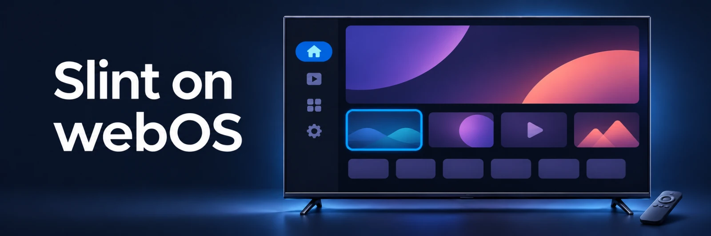

# slint-webos

**Build native LG webOS TV apps with Rust and Slint.**

[SDL-webOS][sdl] handles the Wayland window, remote and pointer input, and app lifecycle.
FemtoVG renders through OpenGL ES.

## Add it to a Slint app

Add these crates.io dependencies to your app's `Cargo.toml`.

```toml
[dependencies]
slint = { version = "1.19", default-features = false, features = ["std", "compat-1-2"] }
slint-webos = "0.1"
```

Call `slint_webos::init()` once on the main thread before creating any Slint components.
Run the app with Slint's usual `ComponentHandle::run()`.

```rust
use slint::ComponentHandle;

slint::slint! {
    #[edition = "1.19"]
    export component App inherits Window {
        Text { text: "Hello, webOS!"; }
    }
}

fn main() -> Result<(), slint::PlatformError> {
    slint_webos::init()?;
    App::new()?.run()
}
```

For separate `.slint` files, add `slint-build = "1.19"` to your build dependencies and use the
same resolved Slint version for the compiler and runtime. Use `init_with_settings()` to set
the initial window size, display mode, or UI scale.

## Build for webOS TV

The Rust target is `armv7-unknown-linux-gnueabi`, including TVs with a 64-bit kernel and
an ARM32 userspace for native apps. Use Rust 1.98.1 or newer and the latest
[buildroot-nc4 ARM TV SDK][sdk].

On Linux, extract the SDK for your host architecture and run its `relocate-sdk.sh` in its
final location. Then build from your application's directory.

```sh
rustup target add armv7-unknown-linux-gnueabi
export WEBOS_SDK=/path/to/relocated-sdk
export CARGO_TARGET_ARMV7_UNKNOWN_LINUX_GNUEABI_LINKER="$WEBOS_SDK/bin/arm-webos-linux-gnueabi-gcc"

cargo build --release --target armv7-unknown-linux-gnueabi --bin my-tv-app
```

The crates.io package ships an ARM SDL-webOS archive. Cargo links it statically
along with the SDK's glibc polyfills. The SDK also supplies the cross-linker and sysroot.

The crate also includes a `Dockerfile` that sets up the SDK and Rust target on amd64 and arm64.
With that image, run the same Cargo build command from your mounted application directory.

### Source checkouts and custom SDL builds

A source checkout builds the pinned SDL-webOS revision with CMake, pkg-config, gawk,
curl, and standard Linux build utilities. On the first build it fetches the archive
from GitHub and verifies its SHA-256 checksum. The pinned revision includes the
upstream relaunch fix. Set `SLINT_WEBOS_BUILD_DIR` to share a writable SDL build cache
across builds. With `CARGO_NET_OFFLINE=true`, the source build reports a cache miss
without contacting GitHub.

Set `SDL_WEBOS_PREFIX` to use an equivalent prebuilt static-only SDL-webOS installation
from an absolute path. The prefix must contain
`lib/libSDL2.a` and `include/SDL2/SDL_config.h` with the Wayland webOS extension enabled.
Use an SDL-webOS revision that includes the relaunch fix if your app handles relaunch events.

## Package and install

Use the packaging helper included with the crate. It requires Python 3 and GNU `readelf`.
Keep the binary's symbol table until packaging is complete so the helper can verify the ARM
ABI and static linkage. The command below locates the resolved crate through
[Cargo metadata][cargo-metadata].

```sh
crate_dir=$(
    cargo metadata --locked --format-version 1 --filter-platform armv7-unknown-linux-gnueabi |
        python3 -c 'import json, pathlib, sys
packages = json.load(sys.stdin)["packages"]
package = next(package for package in packages if package["name"] == "slint-webos")
print(pathlib.Path(package["manifest_path"]).parent)'
)
```

Use `examples/webos/appinfo.json` from that directory as a template. Set your app ID,
title, version, and vendor, then put the manifest and your PNG icon in your app's `webos/`
directory. Set `handlesRelaunch` to `true` to bring the running app back to the foreground
when it is launched again.

```sh
python3 "$crate_dir/tools/package.py" \
    --binary target/armv7-unknown-linux-gnueabi/release/my-tv-app \
    --appinfo webos/appinfo.json --icon webos/icon.png

ares-install -d tv dist/com.example.mytvapp_0.1.0_arm.ipk
ares-launch -d tv com.example.mytvapp
```

Use the [webOS CLI][cli] with a TV configured for Developer Mode. Replace `tv` with
your device name and use the app ID and version from your manifest.

## Backend behavior

- The backend supports one live top-level window, in-window popups, and the system clipboard.
  Fullscreen uses the TV compositor's drawable size.
- Remote arrows and OK map to arrow and Return keys. Back goes to the active popup first
  and otherwise requests window closure. Use `Window::on_close_requested` for app navigation.
- Focusing an editable field opens the TV's on-screen keyboard. The backend forwards
  committed text and input method composition to Slint.
- The SDL event loop drives timers, animations, and `slint::invoke_from_event_loop`.
  Drawing pauses while the app is backgrounded or the window is hidden or minimized.

The SDL backend also runs on Linux and macOS with desktop SDL2 and OpenGL.

## Counter example

The crate includes a counter with remote, pointer, and text input in `examples/counter.rs`.
From a source checkout with desktop SDL2 installed, run `cargo run --example counter`.

## Licensing

`slint-webos` is MIT-licensed. SDL-webOS retains its own license, and Slint has separate
[licensing terms][slint-license]. The packaging helper includes the backend and SDL-webOS
notices and accepts your application's dependency and asset notices via `--notice`.

[sdk]: https://github.com/openlgtv/buildroot-nc4/releases/latest
[sdl]: https://github.com/webosbrew/SDL-webOS/tree/c7bf0a722739ac734a97f66105f0fbf1cc56443c
[cargo-metadata]: https://doc.rust-lang.org/cargo/commands/cargo-metadata.html
[cli]: https://webostv.developer.lge.com/develop/tools/cli-dev-guide
[slint-license]: https://slint.dev/pricing
